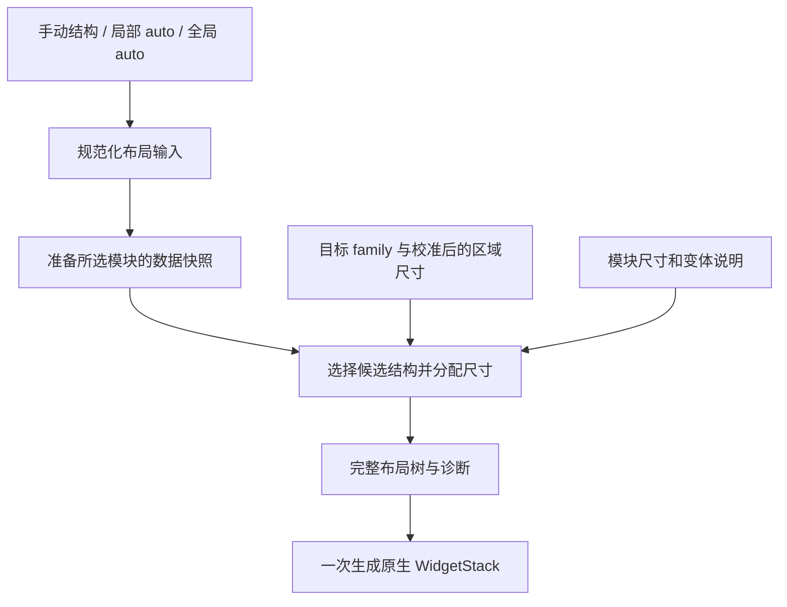

# Scriptable 布局系统与自动布局调研

调研日期：2026-10-27（Asia/Shanghai）。范围：当前仓库 `d9c72f8` 的布局实现、Scriptable 官方 API、SwiftUI 官方布局资料、W3C Flexbox/Grid 规范、Yoga 官方文档与源码。本文记录能力边界和候选方向，**不是已经批准的设计规格或实施计划**。本次没有运行 Scriptable/iOS 真机实验，不能据此承诺原生排版、尺寸测量或依赖运行兼容性。仓库结论来自静态源码与测试用例审阅；调研时 worktree 未安装依赖，未执行测试。

后续实现已采用无版本标记的新 DSL，`auto` 自由重排，`flow` 保持顺序，并支持手动结构中嵌套自动区域；不保留旧布局兼容。最新接口见 [布局指南](../LAYOUT.md)。本文保留调研时的判断和待决问题，不能用其中的兼容建议替代后续决定。

下文仓库引用均为 `d9c72f8` 的历史路径与行号，部分文件已被重写或删除。可用 `git show d9c72f8:路径` 查看对应源码。

## 结论

**推荐“声明式布局树 + 模块变体/尺寸契约 + 有限候选布局选择”，最终编译为 Scriptable 原生 stack。** 用户已明确的目标是类似 `auto[rain, current, future]`：用户指定所有需要显示的模块，engine 自动安排它们的位置与尺寸。因此 auto 的职责是排版，不能通过偷偷删除指定模块来制造“放得下”的结果。

这项建议来自一个限制：Scriptable 能创建原生布局，但公开 API 没有提供原生文字的测量接口、子元素排版后的几何信息或完整 Flexbox/Grid 求解器。直接移植现代布局库不能补上这些缺口。[WidgetStack](https://docs.scriptable.app/widgetstack/)、[WidgetText](https://docs.scriptable.app/widgettext/)、[DrawContext](https://docs.scriptable.app/drawcontext/)

“modern”在这里更适合解释为：结构与内容分开、样式具有局部作用域、模块声明尺寸需求和适配方式、同一份内容能选择不同布局、布局结果可以解释。建议让手动、auto 和 semi-auto 共用一种布局树，而不是分别发展三套系统。

## 1. 现有 layout：问题不只在语法

当前流程是 `createWidget → 逐行解析 → executeItem → 立即创建原生 stack / 调用内容方法`。文本缩进只方便阅读，执行前会被 trim；ASCII 语法则先收集各列，再在分隔线处输出，最后补一次 flush。两者最终都依赖同一套可变状态，没有可在渲染前分析的布局树。`src/widget.ts@d9c72f8:L107–125`、`src/layout/engine.ts@d9c72f8:L30–84`

| 本地事实 | 对自动布局的影响 |
| --- | --- |
| `row()` 总在 widget 下创建，`column()` 总在当前 row 下创建；`row(80)` 设置高度，`column(90)` 设置宽度。默认布局有固定 90 的右列。`src/layout/engine.ts@d9c72f8:L73–84`、`src/user.ts@d9c72f8:L5–18` | 现有 DSL 表达的是两层行列命令；原生 Scriptable 的任意嵌套能力尚未成为通用布局输入。 |
| `left/right/center` 改写共享 `currentAlignment`，内容方法通过 `align()` 加包装 stack 和 spacer。`src/layout/engine.ts@d9c72f8:L90–107` | 新树需要明确的节点样式作用域；仅加嵌套语法仍会遇到兄弟节点受前一条指令影响的问题。 |
| `current/future/forecast/rain` 一边获取数据，一边创建 UI；内部自己设置 padding、方向、固定图标尺寸等。`src/items/weather.ts@d9c72f8:L5–58`、`src/items/forecast.ts@d9c72f8:L5–43`、`src/items/rain.ts@d9c72f8:L5–20` | engine 不知道模块在给定宽度下需要多少高度，不能直接试渲染多个候选。必须把数据准备、尺寸描述与最终渲染分开。 |
| 日期已有“有事件时用小日期”的局部适配；预报数量取自偏好并受数据长度约束；事件数量在数据层截取，标题行数又在渲染层按事件总数决定。`src/items/calendar.ts@d9c72f8:L5–25`、`src/items/calendar.ts@d9c72f8:L83–89`、`src/items/forecast.ts@d9c72f8:L30–34`、`src/data/agenda.ts@d9c72f8:L33–48` | 已有适配行为可以整理成模块能力，但尚不构成按可用面积规划的协议。 |
| `createWidget` 没有接收目标 family；入口先创建 widget，再调用对应尺寸的 preview。`src/entry.ts@d9c72f8:L9–19` | auto 必须在规划前得到目标 family。App 内预览需要显式传入所选尺寸，不能只依赖运行环境。 |
| 自定义函数优先于内置指令；其 `this` 是 custom 对象，还可在 row 前接收同一个空对象。内置方法通过动态查找调用。`src/layout/engine.ts@d9c72f8:L5–27`、`tests/layout-directives.test.ts@d9c72f8:L21–35` | 旧字符串不能一概当成纯声明式语法重编译；兼容路径要保留这些行为，新自动布局则需要明确的模块注册与尺寸描述。 |
| 任何对象形式的 layout 都被当成旧 `RuntimeSettings`；当前类型仅允许字符串或完整设置对象。`src/widget.ts@d9c72f8:L28–35`、`src/types/rendering.ts@d9c72f8:L5–18` | 新对象 DSL 需要版本/类型标识与独立识别分支，不能只把字符串换成对象。 |
| 构建产物把用户区放在引擎区前；更新保留原用户区内容。`scripts/build.mjs@d9c72f8:L33–46`、`src/setup/script-format.ts@d9c72f8:L138–147` | 若采用 `layout.auto(...)` 等 builder，必须处理初始化时序，不能在用户区立即访问尚未初始化的引擎对象。纯数据对象或延迟求值是可研究的选择；保留字符串兼容才能服务现有安装。 |
| mock 只记录子节点、方向、尺寸赋值等，不执行原生排版；天气错误提示还会在布局结束后追加到根节点。`tests/helpers/scriptable.ts@d9c72f8:L17–35`、`src/widget.ts@d9c72f8:L125–126` | 自动化测试可以检验决策和树，不能证明像素层面不溢出；错误、空态和来源信息也需要计入空间预算。 |

据此，最有价值的改造点是建立一个能返回完整布局结果的规划模块：输入是所选内容、目标区域与约束，输出是树、分配尺寸和诊断。解析器和原生 renderer 围绕它工作，避免尺寸逻辑继续散落到每个调用方。此处为研究建议，尚未修改实现。

## 2. Scriptable 的能力与边界

| 主题 | 官方事实或文档边界 | 对重设计的含义（研究判断） |
| --- | --- | --- |
| 基础容器 | `WidgetStack` 可嵌套，支持水平/垂直排列；有 `spacing`、四边 padding、`size` 与内容对齐。尺寸某一维不大于 0 时由系统决定；这不是“明确分配剩余空间”的承诺。[WidgetStack](https://docs.scriptable.app/widgetstack/) | Row/Column 可以成为稳定底层节点；不要把 native auto size 命名成精确 `grow`。 |
| 弹性空间 | `WidgetSpacer` 的长度为 null 时具有弹性。[WidgetSpacer](https://docs.scriptable.app/widgetspacer/) | 可表达把内容推向两端/中间；多个 spacer 的分配与压缩行为需实测，不应等同于 CSS `flex-grow` 权重。 |
| 文本收缩 | `lineLimit` 限制行数，`minimumScaleFactor` 控制允许缩小的下限；默认缩放下限为 1。[WidgetText](https://docs.scriptable.app/widgettext/) | 这些设置不能证明内容一定放得下；截断会丢信息，缩字应有可读下限。 |
| 图像 | `WidgetImage` 支持显式 `imageSize`、可缩放开关与 fit/fill 内容模式。[WidgetImage](https://docs.scriptable.app/widgetimage/) | 图标和图表可以有明确尺寸契约，通常比可变长文本更容易纳入预算。 |
| 可用尺寸 | `config.widgetFamily` 返回 family 或 null；`Device.screenSize()` 返回屏幕点尺寸，`screenResolution()` 返回屏幕像素尺寸。[config](https://docs.scriptable.app/config/)、[Device](https://docs.scriptable.app/device/) | family 不是实际内容矩形；屏幕尺寸也不是 widget 尺寸。需要独立的尺寸配置/校准层，不能把某款 iPhone 的尺寸表当作平台保证。 |
| 测量 | 检索到的 `WidgetStack`/`WidgetText`/`DrawContext` 公开方法中没有原生 `measureText`、`sizeThatFits` 或渲染后 frame 查询。[WidgetStack](https://docs.scriptable.app/widgetstack/)、[WidgetText](https://docs.scriptable.app/widgettext/)、[DrawContext](https://docs.scriptable.app/drawcontext/) | 不能可靠地“先渲染、读取溢出、重排”；第一阶段应依靠预定义变体、保守尺寸预算和验证过的模板。未文档化能力不作为契约。 |
| 自由绘制 | `DrawContext` 可指定画布大小，在点/矩形中绘制文字、图形和图片，输出 `Image`。[DrawContext](https://docs.scriptable.app/drawcontext/) | 适合局部趋势图；把整张 widget 栅格化会失去内部独立的原生文本/日期节点和分区链接，需要自己承担文字排版。 |
| 交互 | 小号 widget 只能有 widget 级单一点击目标；官方文本/stack 链接文档明确提到 medium/large 的内部链接。[WidgetText](https://docs.scriptable.app/widgettext/#url) | 布局器应理解 family 能力，不能在 small 中承诺多个独立点击区；其他 family 的细节另做验证。 |
| 锁屏 | `accessoryInline` 只呈现一个图像和一个文本，其余元素会被过滤；官方也说明锁屏预览只是近似。[ListWidget](https://docs.scriptable.app/listwidget/#-presentaccessoryinline) | 锁屏不能只当作更小的主屏矩形；三个独立模块的通用 auto 不应默认承诺支持所有 family。 |
| 资源与刷新 | 官方说明 widget 有内存限制，但没有在该页公布通用固定数值；刷新由系统调度，`refreshAfterDate` 是最早刷新时间而非精确计时器。[ListWidget](https://docs.scriptable.app/listwidget/) | 计算应有界，并用同一数据快照一次规划；不要把不断重新求解/实时重排当作默认运行模式。 |
| WebView | `WebView` 可加载 HTML、执行 JavaScript；原生 widget 的公开子元素接口没有 `addWebView`。[WebView](https://docs.scriptable.app/webview/)、[ListWidget](https://docs.scriptable.app/listwidget/) | 浏览器可用于编辑器/近似预览，但 HTML/CSS 布局不能直接成为原生 widget 子树。浏览器测量值与原生文字一致性仍须验证。 |

以上“没有”均指本次核查的**公开 API 没有列出**，不表示已经逆向证明底层实现绝不具备该能力。尤其不应从 Apple 新版 WidgetKit/SwiftUI 功能反推 Scriptable 已经暴露相同接口。

## 3. 值得借鉴的现代布局模型

### SwiftUI：尺寸提案与候选视图

Apple 的 `Layout` 协议把尺寸计算与子视图放置分开；`ViewThatFits` 则从候选视图中选择适合可用空间的一个。官方示例让同一组按钮在水平与垂直布局间切换。[Apple WWDC22：Compose custom layouts with SwiftUI](https://developer.apple.com/videos/play/wwdc2022/10056/)

对本项目最有价值的是**先选择表现形式，再渲染**：例如天气保持相同字段、改为横排或竖排，窄空间使用经过验证的换行方式。Scriptable 没有公开同等测量协议，因此这里只借鉴候选选择语义，不能直接调用 SwiftUI，也不能承诺与 `ViewThatFits` 同样准确的 intrinsic-size 判断。

### Flexbox / Yoga：一维弹性分配

Flexbox 定义主轴/交叉轴、grow/shrink、basis、换行及对齐，并通过嵌套表达二维结构。Yoga 实现以 Flexbox 为主的 CSS 子集，负责计算盒子位置与尺寸，本身不绘制内容。[W3C Flexbox](https://www.w3.org/TR/css-flexbox-1/)、[Yoga 概述](https://www.yogalayout.dev/docs/about-yoga)

Yoga 对文字等外部内容需要 measure function，计算结果含尺寸和相对父节点偏移。其当前官方 JavaScript 入口加载 WASM 并使用 ESM/top-level await；这说明引入它涉及运行时和构建适配，**不构成它一定无法在 Scriptable 中运行的证据**。[Yoga 外部测量](https://www.yogalayout.dev/docs/advanced/external-layout-systems)、[Yoga 布局树](https://www.yogalayout.dev/docs/getting-started/laying-out-a-tree)、[官方 JavaScript 入口源码](https://github.com/react/yoga/blob/main/javascript/src/index.ts)

研究判断：可以借鉴显式 gap、尺寸上下界、比例分配和轴向语义；不建议第一阶段引入完整 Yoga。即使求解器成功运行，仍需解决原生文字测量以及计算坐标到 stack 层级的映射。native stack 也没有公开任意 x/y 放置接口，任意 Flexbox 布局结果不等于可无损编译的 stack 树。

### Grid：命名区域与自动放置

CSS Grid 用二维轨道、网格区域与自动放置表达布局，支持固定/弹性轨道以及命名区域；完整算法还处理内容尺寸、跨轨道与隐式轨道。[W3C Grid Level 2](https://www.w3.org/TR/css-grid-2/)

研究判断：**命名区域适合 semi-auto，完整 CSS Grid 不是必要目标。** 用户可固定 `hero` 或 `agenda` 区域，让系统在其他区域安排指定模块。第一阶段只允许能分解成 Row/Column 的模板；跨行跨列、重叠、masonry 和任意网格拓扑另行评估。否则看似简单的 `span` 会把原生 renderer 推向自绘坐标系统。

## 4. 候选路线比较

下表是基于上面资料的工程判断，不是库性能或真机兼容性实测。

| 路线 | 能改善什么 | 对 auto / semi-auto 的支撑 | 代价和限制 | 判断 |
| --- | --- | --- | --- | --- |
| A. 声明式树直接映射原生 stack | 嵌套布局、局部样式、结构校验、复用 | 可按 family 切换树；自动安排所选模块还需模块尺寸信息 | 改了语法还不等于拥有自动布局 | 适合做底层，但单独不足 |
| B. 声明式树 + 模块变体 + 有限模板/槽位 | 在 A 上加可解释的结构、尺寸和密度适配 | 保留全部所选模块，系统选模板、变体和空间分配；未来可锁定局部结构 | 需要为模块建立尺寸/内容契约；须真机校准 | **推荐** |
| C. 通用 Flexbox/Yoga 或完整 Grid 求解 | 更通用的约束和自由布局 | 在给定树与内容尺寸后求解几何；仍需选择结构并提供模块测量 | 测量、运行时、坐标映射、包体与资源成本都未解决 | 保留为后续专项研究 |

整张 widget 通过 HTML/Canvas/DrawContext 生成图片是另一种 renderer 选择，不是上述三条的天然替代：它能表达自由坐标，但会把文字排版、局部交互和原生日期行为一起改写。更稳妥的使用范围是局部图表，而不是第一阶段的默认渲染路径。[DrawContext](https://docs.scriptable.app/drawcontext/)、[WidgetImage](https://docs.scriptable.app/widgetimage/)、[WebView](https://docs.scriptable.app/webview/)

## 5. 面向 auto / semi-auto 的研究建议

以下名称和职责是讨论用概念，不是已批准 API。

### 先定义哪些事由系统决定

- **Manual**：用户给出完整结构；系统校验，并对不支持或超预算的配置给出诊断。
- **Auto（用户已明确）**：用户列出需要显示的模块；系统选择这些模块的排列方式、尺寸和合适的表现变体，全部模块都必须保留。以后才考虑是否需要更自由的拓扑搜索。
- **Semi-auto（后续建议）**：用户固定一部分 Row/Column/区域结构，在其中放入 auto 子树；engine 只安排这棵子树内的指定模块。

这三个模式应共用模块和 renderer，差别在于 planner 有多少自由度。输入列表顺序是否必须保持，还是仅表达成员集合，仍需在设计时确认；没有确认前建议保持稳定阅读顺序。按业务价值替换/淘汰模块不属于当前 auto 需求。

### 模块要提供什么信息

模块需要稳定 ID、支持的 family、数据是否可用、有限展示变体和每个变体的保守尺寸预算。字体、语言、单位和字段开关都影响空间需求，应随数据快照进入规划输入。建议变体默认保留信息，只调整横竖结构、换行、间距与可读范围内的字号。隐藏描述、减少日程数量或缩短预报序列属于信息缩减，这部分产品行为尚未确定，适合设为独立选项；不能将空白渲染称为 compact。数据缺失应有明确空态；“不适合这个区域”和“没有数据”应产生不同原因。旧的自定义渲染函数可作为不透明模块保留，但未声明尺寸前不参与自动拼装。

不把 `minHeight` 或估计文本宽度包装成已测量的原生大小。对于长日程标题、中文日期、双位数负温度等内容，使用经验证的宽度档位与最小可读字号；行数截断若会丢失信息，也应服从明确的模块显示规则。只有内容契约明确，自动规划才不必靠试错渲染猜空间。

### 规划需要可复现，也需要解释失败

建议以 family 与模板先限制候选，按稳定规则选择变体；同一输入得到同一结果。候选应按模块约束生成，例如单列、多列、全宽条加分栏；`rain/current/future` 是验收样例，不应被硬编码为唯一可自动排列的组合。全部指定模块必须保留，锁定位置、约定阅读顺序和最小字号应作为硬约束。软偏好不能偷偷覆盖硬约束；即使全部模块已用最紧凑变体仍放不下，也应返回具体冲突并提示改用更大 family/减少所选内容，不得声称布局成功。

每次结果附带简短原因，例如“future 采用紧凑变体”“rain 数据不可用，显示空态”“当前 family 无法容纳全部三个模块”。模板数、变体数与搜索步数应有限；不需要一开始就引入通用约束求解或机器学习。

### 尺寸适配如何落到原生 stack

建议把模块尺寸描述为“给定可用宽度时，此种表现形式的最小/理想高度”，并声明支持的宽度范围，而非单个固定 `minWidth × minHeight`。文字换行使宽高相互依赖；这些数字属于估计或校准结果，需注明来源。规划时扣除容器 padding 和 gap，分配剩余空间，再转换为支持的嵌套 stack 与显式 size。比例宽度可以由自己的规划器计算，不需要假定 Scriptable 存在原生 `flex-grow`。[WidgetStack 的公开尺寸与间距能力](https://docs.scriptable.app/widgetstack/)

候选评估只操作数据，不拉网络、不创建原生视图，也不反复调用旧自定义回调。对同一数据快照先选择布局，再渲染一次。未知设备尺寸应标记为估计，并采用保守配置；成功找到估计可行解与真机确认不溢出是两件事。这个划分还允许以后替换估算方法，而不重写用户布局和所有内容模块。

## 6. 用 `auto[rain, current, future]` 检验推荐路线

当前三个名字具有不同的内容与尺寸特征，不能只把三个现有 stack 等分宽度：

| 模块 | 当前实际内容 | 需要描述的尺寸变化 |
| --- | --- | --- |
| `rain` | 成功时是短临状态文字、更新时间与 QWeather 来源链接；失败或不支持时是提示文本，当前没有降雨图表。`src/items/rain.ts@d9c72f8:L5–41` | 主句受语言与状态影响，来源行也占高度；适合研究宽条和窄列两种排版。 |
| `current` | 位置、图标/温度、天气文字、最高最低温按偏好组合；温度条已有固定 60×30 stack。`src/items/weather.ts@d9c72f8:L14–69` | 不同字段开关和横竖组合改变所需高度，不能只给最外层 stack 改 size。 |
| `future` | 按时间切换“下一小时/明天”，并可能显示昼夜两行降水概率；它不是多时段 forecast 列表。`src/items/weather.ts@d9c72f8:L85–147` | 同一模块在两个时段所需空间不同，必须在准备数据后明确当前表现形式。 |

可比较的结构包括 `column(rain, current, future)`、`column(rain, row(current, future))`、`row(rain, current, future)`。这些是**候选树示意，不是已实现语法或已证实能放进某个 family 的结果**。规划器应按可用宽高、每个模块的尺寸说明及阅读顺序约束排除不可行结构，再在可行结构中选择可读性更好的尺寸分配。小号空间若无法容纳全部模块，应明确报告冲突。

未来 semi-auto 可表达为 `column(date, auto[rain, current, future])`：用户固定 date 在上方，其余区域由同一个 auto 规划器安排。这需要真正的递归树，以及把父节点剩余区域传给 auto 子树的能力。

语法上，建议先比较带版本标识的纯数据对象与延迟执行的 builder；二者都可以表达上述结构。用户给出的 `auto[...]` 在本文表示意图，不直接认定为最终 JavaScript 语法。避免现在就把界面语法、执行时序和兼容策略绑死。

## 7. 实施前最有价值的验证

这些是后续实验建议，本次均未执行：

1. **尺寸配置**：用户实际 iPhone/iPad、各目标 family、显示缩放与系统版本下的实际内容区域。预览与主屏分别检查，记录点尺寸而非只记录屏幕像素。
2. **原生分配行为**：显式 stack 尺寸、内边距、间距、多个 flexible spacer、过长文本同时出现时如何压缩/裁切；尤其不要假定它们遵循 CSS 算法。
3. **模块变体**：中文/英文长文本、多日事件、全天事件、缺失天气与大量预报项的最坏情况；确认 compact 仍然可读。
4. **约束策略**：把锁定模块与超量内容组合，验证不会静默丢失任何指定模块；重复相同输入不产生布局抖动。验证 `auto[rain,current,future]` 在各目标 family 的可行与不可行情况。
5. **运行资源**：对照当前 renderer，测单次运行时间、图像分配和最复杂候选数；官方没有保证的具体内存/时限不得写成硬编码平台常数。
6. **预览可信度**：浏览器或 Node mock 能验证布局树和决策，不能验证 Scriptable 原生字体、实际压缩规则、点击行为及 widget 内存表现。

## 8. 调研留下的决策

- auto 列表的顺序是否是必须保持的阅读顺序？当前用户已经确定指定模块必须全部显示。
- 模块变体最多能调整多少内部信息密度？例如 current 可否省略天气描述、future 可否合并昼夜降水信息，需作为契约明确。当前建议先只做保留信息的排版变化。
- semi-auto 是否采用“手动结构中嵌套 auto 子树”？这是当前建议，尚未批准。
- 先覆盖目前常用的主屏 family，还是同步覆盖 iPad 与锁屏？它们需要分别建立能力与尺寸契约。
- 自定义项是否必须立即获得自动适配，还是先按固定区域保留？自动适配需要它们提供尺寸/变体信息。

当前资料支持先推进路线 B 的进一步设计与小范围真机验证；尚不足以宣称任何候选已经能无损替换现有布局或自动容纳任意内容。
